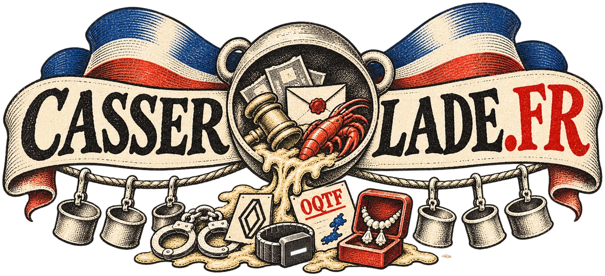

<p align="center">
  <a href="https://casserolade.fr"></a>
</p>

<p align="center">
  <strong>Casseroles et tambouille politique</strong><br>
  Un pastiche de la politique française, déguisé en autobattler.
</p>

<p align="center">
  <a href="https://casserolade.fr"><strong>▶ Jouer sur casserolade.fr</strong></a>
  · <a href="https://casserolade.fr/bestiaire">Le bestiaire</a>
  · <a href="https://casserolade.fr/a-propos">À propos</a>
  · <a href="#contribuer">Contribuer</a>
</p>

<p align="center">
  
  
  
  <a href="CHANGELOG.md"></a>
</p>

<p align="center"></p>

## Ce que c'est

Casserolade n'est pas vraiment un jeu. C'est un pastiche de la politique française, sous la forme d'un gigantesque mashup numérique :

- **Hearthstone Battlegrounds** ou TFT pour le gameplay : un autobattler stratégique, avec ses synergies, ses sorts et ses compositions ;
- **South Park** pour le ton, l'irrévérence et les avatars en marionnettes découpées ;
- **une boîte à sons géante** : plus de 650 répliques politiques, dont près de 250 avec la vraie voix.

La forme est celle des autobattlers : on recrute ses troupes, on fait grandir son plateau, puis les combats se jouent tout seuls. Sauf qu'ici, les troupes sont de vrais politiques, et chaque manche se joue sur un plateau télé, et plutôt les pires : Cyril Hanouna, Pascal Praud sur CNews, PPDA de retour au 20 heures de TF1. La lie de la télé, jusqu'au débat d'entre-deux-tours.

Les casseroles sont leurs vraies affaires et leurs vrais ridicules. Dans le jeu, une casserole ne coule personne : elle rend plus fort. Deux casseroles font un scandale, le scandale dure deux manches, puis le peuple oublie, et il ne reste que l'avantage. Ce n'est pas une règle inventée pour le jeu, c'est une observation.

Le ton est trash, mais sur le fond, rien n'est inventé. Chaque affaire est réelle et datée, chaque citation est mot pour mot. Quand un politique parle, c'est sa vraie voix ; sinon, sa phrase s'affiche. Tous les camps prennent les mêmes coups, et aucun ne gagne d'office : l'équilibrage est la seule neutralité qu'on doit à tout le monde.

Gratuit, sans publicité, sans inscription, sans rien à vendre.

<p align="center">
  
  
</p>

## Comment ça se joue

- **Huit joueurs, un seul survivant.** Chacun choisit son héros parmi trois candidats. Chaque manche, on recrute, puis on affronte un adversaire. Le perdant perd des sondages ; à zéro, il est éliminé.
- **Le budget ne se garde pas.** 3 au départ, +1 par manche jusqu'à 10 : on recrute un politique (3), on actualise la boutique (1), on monte d'échelon pour des politiques plus forts, on achète des sorts et des casseroles.
- **Une réserve partagée**, comme dans Battlegrounds : chaque politique existe en nombre limité pour les huit joueurs, de 15 exemplaires à l'échelon 1 à 7 au 6. Ce que les autres prennent sort moins chez vous.
- **Trois exemplaires du même politique** en font un doré, qui donne une **Investiture** : la découverte d'un politique de l'échelon au-dessus.
- **Les camps se parlent par le texte des cartes** : Annonces, Fins de tour, Héritages, Ralliements, Tracts, Revanches… Les moteurs se croisent, et les plateaux grandissent au recrutement.
- **Le combat est automatique**, de gauche à droite, avec des cibles tirées au hasard, sauf le **Porte-parole**, qu'on doit attaquer d'abord.
- **Les casseroles** donnent un avantage tout de suite, et le double sur leur propriétaire. Leur défaut dort jusqu'au scandale.
- **Après une victoire, la Célébration** : un survivant prononce sa petite phrase, une Vedette d'abord, et chaque survivant qui a une Célébration en tire un gain. **Après une défaite, le Droit de réponse** : chaque politique qui en a un joue le sien, et le plus à gauche répond.

Tous les mots-clés sont expliqués dans [le bestiaire](https://casserolade.fr/bestiaire?type=mot_cle), et au survol de chaque carte en jeu.

## Ce qu'il y a dedans

| | |
|---|---|
| **28 héros** | Les candidats déclarés à la présidentielle de 2027, et quelques autres. Chacun a son pouvoir. |
| **106 politiques** | Sept partis, plus la Société civile et son Panthéon d'anciens présidents à l'échelon 6. |
| **65 casseroles** | Les affaires et les ridicules publics, datés et sourcés dans `src/data/casseroles.ts`. |
| **26 sorts** | Tract, Note de frais, Temps de parole, Remaniement, Congrès… |
| **657 répliques** | Toutes sourcées, dont 244 avec la vraie voix, en effets sonores courts. |
| **14 plateaux télé** | De France 3 jusqu'au débat de TF1, chacun avec son animateur à son pupitre. |
| **Des contextes** | La règle du jour, tirée pour la partie, comme les Anomalies de Battlegrounds. |
| **Des modes** | Seul contre l'ordinateur, la carrière (sept élections, du canton au second tour), parties publiques et salons entre amis par lien. |
| **[Le bestiaire](https://casserolade.fr/bestiaire)** | Tout le jeu, avec des filtres : mots-clés, héros, politiques, casseroles, sorts, jetons, contextes. Chaque fiche donne ses sources. |

## Contribuer

Casserolade est libre, et le jeu est encore jeune : vos retours, en jouant comme en lisant le code, le font avancer. Trouver les bons extraits, découper proprement les sons, vérifier chaque affaire, ça prend du temps, et les bonnes idées viennent de partout.

- **Une erreur** dans une affaire, une date, une citation ? Ouvrez une *issue* : « rien d'inventé » ne tient qu'avec beaucoup d'yeux.
- **Une casserole oubliée, une petite phrase mémorable, un politique qui manque ?** Proposez-la, avec sa source.
- **Un extrait audio authentique, bien découpé ?** C'est le plus rare. On ne synthétise jamais la voix de quelqu'un : sans vrai extrait, la phrase s'affiche en texte.
- **Une règle mieux pensée, un bot plus malin, un plateau plus ridicule encore, du code ?** Les *pull requests* sont ouvertes.

La ligne éditoriale tient en une phrase : **trash, mais vrai**. On se moque des faits tels qu'ils sont, mot pour mot, avec la source. Pas de blague dont les victimes sont la cible, et seulement des personnalités publiques.

Une carte est une ligne de données, pas du code : ajouter un politique, c'est ajouter une ligne dans `src/data/cards.ts`. Les tests vérifient que chaque identifiant existe et que chaque texte de carte change vraiment quelque chose. Chaque carte déplace l'équilibre : relancez les simulations (plus bas) et notez les résultats dans `docs/04-resultats-equilibrage.md`.

## Lancer le jeu chez soi

Il faut [Node.js](https://nodejs.org) 22.18 ou plus, qui exécute directement le TypeScript.

```sh
npm install
npm run dev        # le jeu dans le navigateur ; le solo et la carrière tournent dans la page
npm run server     # le serveur des parties en ligne (WebSocket, port 8080), pour les salons et les parties publiques
npm test           # le moteur, les données, le protocole, le salon, le client
npm run typecheck  # TypeScript et gabarits Vue
```

Pour l'équilibrage :

```sh
node src/sim/balance.ts --games 2000          # camps et héros
node src/sim/bilan_cartes.ts --games 300      # la force de chaque carte, offerte à un bot contre la même partie sans elle
node src/sim/bilan_dynamique.ts --games 400   # rythme, économie, hasard du combat, placement, cartes
node src/sim/bilan_styles.ts --a '{"rollDown":true}' --b '{}'   # deux façons de jouer, face à face
FUZZ_GAMES=2000 node --test test/fuzz.test.ts # le fuzz long du moteur
```

## Sous le capot

| Dossier | Contenu |
|---|---|
| `src/engine/` | Le moteur : règles, combat à graine, vue par joueur. Sans dépendance, déterministe : une partie se rejoue à partir de sa graine et de son journal. |
| `src/data/` | Cartes, casseroles, sorts, héros, plateaux, animateurs, règles chiffrées. |
| `src/bots/` | Les bots, de débutant à difficile. Ils ne voient que la vue d'un joueur. |
| `src/sim/` | Le simulateur d'équilibrage. |
| `src/server/`, `src/lobby/`, `src/protocol/` | Le serveur WebSocket, les salons, les messages. Un bug n'arrête que sa partie, et laisse de quoi la rejouer (`tools/rejouer.ts`). |
| `src/client/` | L'interface en Vue 3 et Vite, le combat en PixiJS. |
| `tools/` | La production : découpe des photos, rendus Blender des plateaux, effets, génération des voix, des phrases et des sources du jeu. Les outils internes de collecte et d'écoute ne sont pas publiés. |
| `docs/` | La spécification du gameplay, les résultats d'équilibrage, le moteur, la direction artistique. |

Toute action passe par `applyAction`, et toute information par `viewFor` : ni le client ni les bots ne touchent à l'état complet de la partie. Le moteur vérifie ses invariants à chaque manche (`docs/12-moteur.md`).

## Licence

Le code est sous [licence MIT](LICENSE). Les photos, les polices et les sons gardent leur propre licence, indiquée dans `assets/game/credits.json`. Toutes les sources du jeu, phrase par phrase, voix par voix et photo par photo, sont sur [la page À propos](https://casserolade.fr/a-propos) et dans [le bestiaire](https://casserolade.fr/bestiaire).

Les changements de chaque version sont dans le [journal des versions](CHANGELOG.md).
